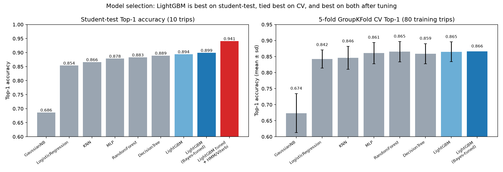
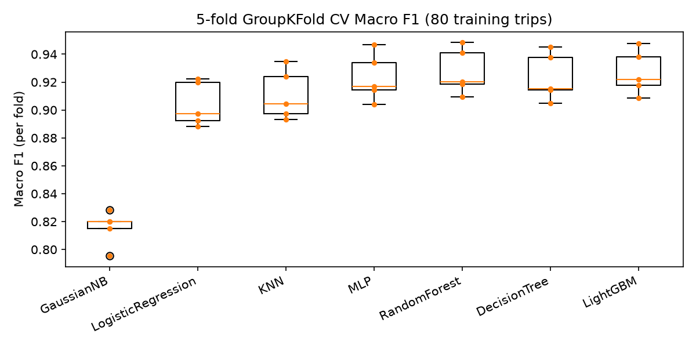
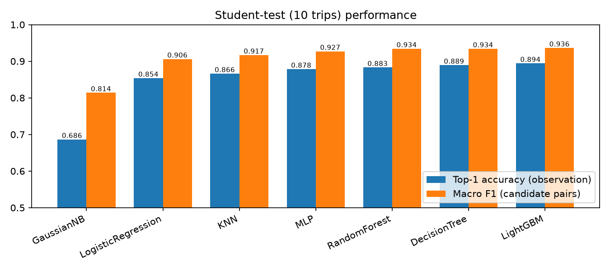
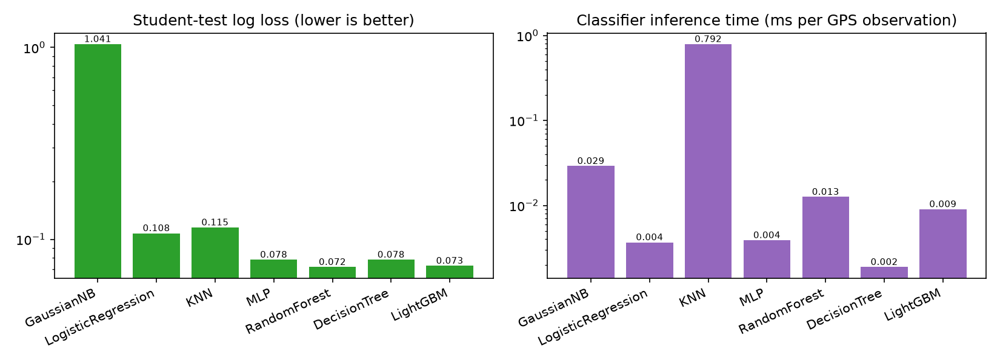
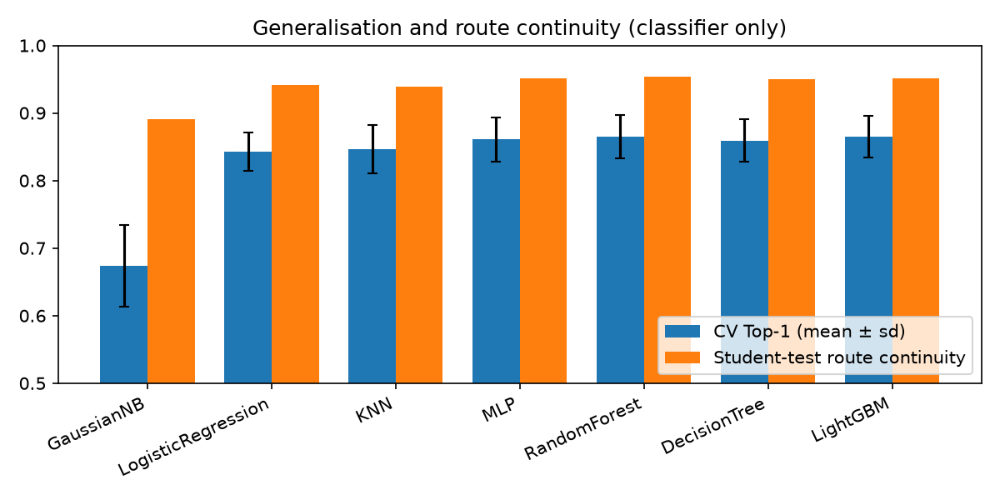
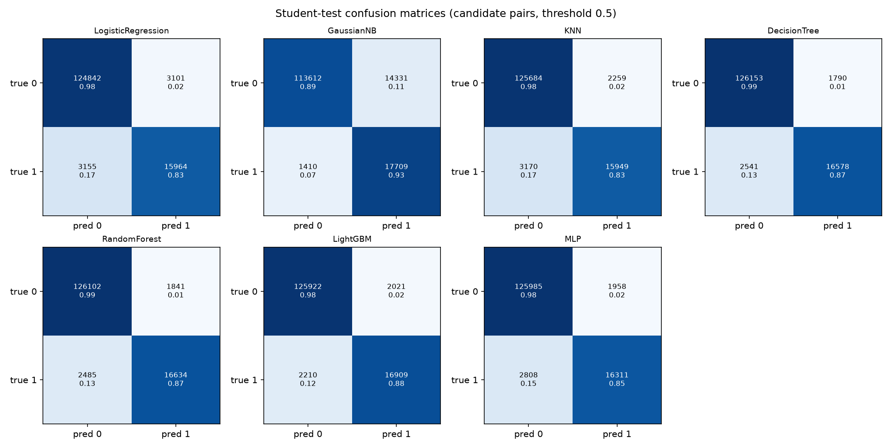

# Model comparison (all 7 models)

Every model is a binary classifier over (GPS observation, candidate road arc) pairs. All models use the same 22 features and the same 5-fold GroupKFold over the 80 training trips (grouped by trip). Each model is then refit on all 80 trips and evaluated once on the 10 student-test (ST) trips. Primary metric: observation-level **Top-1 accuracy** (the highest-scoring candidate per GPS point is the true arc). Click a model for its full page.

| # | Model | Family | CV Macro F1 | CV Top-1 | ST Top-1 | ST Macro F1 | ST log loss | ST continuity | Fit (s) | Inference (ms/obs) |
|---|---|---|---|---|---|---|---|---|---|---|
| 1 | [LogisticRegression](per_model/01_LogisticRegression) | Linear / probabilistic | 0.9041 ± 0.0159 | 0.8424 ± 0.0282 | 0.8537 | 0.9059 | 0.1076 | 0.9413 | 8.6741 | 0.0037 |
| 2 | [GaussianNB](per_model/02_GaussianNB) | Linear / probabilistic | 0.8157 ± 0.0124 | 0.6735 ± 0.0608 | 0.6864 | 0.8138 | 1.0412 | 0.8910 | 6.7067 | 0.0290 |
| 3 | [KNN](per_model/03_KNN) | Instance-based | 0.9108 ± 0.0178 | 0.8459 ± 0.0359 | 0.8660 | 0.9167 | 0.1153 | 0.9391 | 0.0381 | 0.7918 |
| 4 | [DecisionTree](per_model/04_DecisionTree) | Tree-based | 0.9234 ± 0.0170 | 0.8590 ± 0.0313 | 0.8891 | 0.9338 | 0.0783 | 0.9495 | 42.7649 | 0.0019 |
| 5 | [RandomForest](per_model/05_RandomForest) | Ensemble (bagging) | 0.9275 ± 0.0165 | 0.8651 ± 0.0317 | 0.8828 | 0.9340 | 0.0717 | 0.9541 | 35.8037 | 0.0126 |
| 6 | [LightGBM](per_model/06_LightGBM) | Boosting | 0.9269 ± 0.0158 | 0.8648 ± 0.0308 | 0.8941 | 0.9361 | 0.0727 | 0.9510 | 3.8373 | 0.0090 |
| 7 | [MLP](per_model/07_MLP) | Neural network | 0.9233 ± 0.0171 | 0.8606 ± 0.0329 | 0.8783 | 0.9270 | 0.0783 | 0.9510 | 23.2745 | 0.0039 |

**Ranking by student-test Top-1:** LightGBM > DecisionTree > RandomForest > MLP > KNN > LogisticRegression > GaussianNB.  
**Selected:** LightGBM. It is tied with Random Forest on CV, but it is better on student-test, faster and smaller. It was then Bayes-tuned and combined with the HMM/Viterbi decoder.

## Comparison plots

## Files
- `model_comparison.csv`: the table above with every metric
- `cv_fold_results.csv`: every model × fold
- `confusion_<Model>.csv`: student-test confusion matrices
- `per_model/`: one folder per model (README, confusion matrix, fold scores)
- Training code: `scripts/03_train_models.py` (all models) or `scripts/models/train_<model>.py` (one model)
