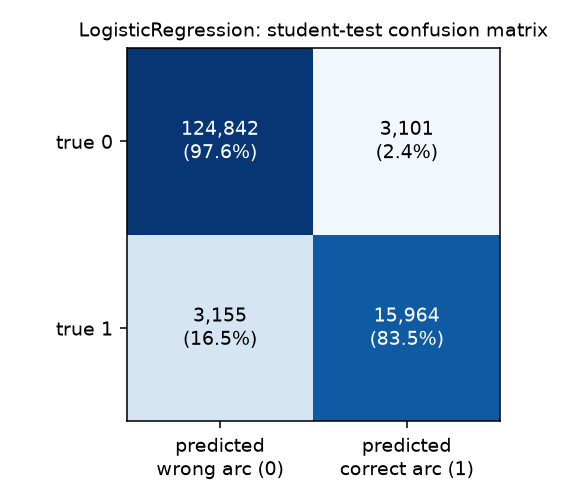

# Model 1: LogisticRegression

**Algorithm family:** Linear / probabilistic  
**Configuration:** StandardScaler + L2 logistic regression, C=1.0, lbfgs, max_iter=500  
**Training rows:** 1,323,512 (observation, candidate) pairs from 80 training trips  
**Training time:** 8.7 s · **Inference:** 0.0037 ms per GPS observation  
**Rank among 7 models:** #6 on student-test Top-1, #6 on CV Top-1

## Headline results

| CV Macro F1 (mean ± sd) | CV Top-1 (mean ± sd) | Student-test Top-1 | Student-test Macro F1 | Student-test log loss |
|---|---|---|---|---|
| 0.9041 ± 0.0159 | 0.8424 ± 0.0282 | 0.8537 | 0.9059 | 0.1076 |

## Why this model was tried
The correct candidate is mostly the one that is relatively close and aligned with the direction of travel. That is close to a monotone (linear in log-odds) relationship in our features. Logistic regression also gives calibrated probabilities, which the HMM emission model needs.

## Strengths and limitations for PathSnap
Strengths: trains in seconds on 1.3 M rows, has well-calibrated probabilities and interpretable coefficients. Limitations: it cannot model interactions (heading only matters when the vehicle is moving; distance matters less at junctions) unless they are engineered by hand.

## Hyper-parameters (initial values)
C = 1.0 (L2), solver lbfgs, max_iter = 500, features standardised.

## Loss / objective
Binary cross-entropy (log loss) + L2 penalty, minimised with L-BFGS.

## Cross-validation: 5-fold GroupKFold over the 80 training trips (grouped by trip)

| Fold | Macro F1 | Top-1 | Log loss | Accuracy | Precision (macro) | Recall (macro) | Train Macro F1 | Fit time (s) |
|---|---|---|---|---|---|---|---|---|
| 0 | 0.8972 | 0.8270 | 0.1450 | 0.9495 | 0.9026 | 0.8920 | 0.9103 | 3.9154 |
| 1 | 0.9225 | 0.8852 | 0.1138 | 0.9601 | 0.9243 | 0.9207 | 0.8987 | 3.3212 |
| 2 | 0.8925 | 0.8168 | 0.1271 | 0.9522 | 0.9052 | 0.8808 | 0.9109 | 7.4630 |
| 3 | 0.9199 | 0.8564 | 0.0984 | 0.9640 | 0.9205 | 0.9193 | 0.9047 | 6.4576 |
| 4 | 0.8884 | 0.8264 | 0.1256 | 0.9511 | 0.9001 | 0.8777 | 0.9108 | 7.2137 |
| mean | 0.9041 | 0.8424 | 0.1220 | 0.9554 | 0.9105 | 0.8981 | 0.9071 | 5.6742 |
| std | 0.0159 | 0.0282 | 0.0173 | 0.0063 | 0.0110 | 0.0207 | 0.0054 | 1.9244 |

## Student-test results (10 trips)

| Metric | Value |
|---|---|
| Observation-level Top-1 accuracy | 0.8537 |
| Macro F1 | 0.9059 |
| Accuracy (candidate pairs) | 0.9575 |
| Precision (macro) | 0.9063 |
| Recall (macro) | 0.9054 |
| Precision (correct-arc class) | 0.8373 |
| Recall (correct-arc class) | 0.8350 |
| Log loss | 0.1076 |
| Route continuity (classifier only) | 0.9413 |

## Confusion matrix (student-test candidate pairs, threshold 0.5)



TN = 124,842 wrong candidates correctly rejected · FP = 3,101 wrong candidates accepted · FN = 3,155 correct arcs missed · TP = 15,964 correct arcs found.

## Over- or under-fitting?
Training Macro F1 = 0.9071, CV Macro F1 = 0.9041 (sd 0.0159 over folds), student-test Macro F1 = 0.9059. Training, CV and student-test scores are close, so there is no significant over- or under-fitting.

## Reproduce
```bash
python scripts/models/train_logistic_regression.py
```
Saved model: `models/experiments/LogisticRegression.joblib`. Raw fold results: [`cv_folds.csv`](cv_folds.csv).
