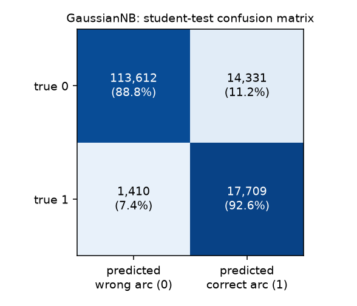

# Model 2: GaussianNB

**Algorithm family:** Linear / probabilistic  
**Configuration:** QuantileTransformer(normal) + Gaussian Naive Bayes, var_smoothing=1e-9  
**Training rows:** 1,323,512 (observation, candidate) pairs from 80 training trips  
**Training time:** 6.7 s · **Inference:** 0.0290 ms per GPS observation  
**Rank among 7 models:** #7 on student-test Top-1, #7 on CV Top-1

## Headline results

| CV Macro F1 (mean ± sd) | CV Top-1 (mean ± sd) | Student-test Top-1 | Student-test Macro F1 | Student-test log loss |
|---|---|---|---|---|
| 0.8157 ± 0.0124 | 0.6735 ± 0.0608 | 0.6864 | 0.8138 | 1.0412 |

## Why this model was tried
A very cheap probabilistic baseline. It shows how much can be gained from modelling feature dependence, which the other models do.

## Strengths and limitations for PathSnap
Strengths: no tuning and near-instant training. Limitations: it assumes the features are independent given the class. Our features are strongly correlated (dist, dist_rank, dist_share, ctx_*), so it counts the same evidence several times and becomes over-confident.

## Hyper-parameters (initial values)
var_smoothing = 1e-9. A QuantileTransformer (normal output) is applied first to make the features closer to Gaussian.

## Loss / objective
No iterative loss: the class priors and per-class Gaussian means/variances are maximum-likelihood estimates.

## Cross-validation: 5-fold GroupKFold over the 80 training trips (grouped by trip)

| Fold | Macro F1 | Top-1 | Log loss | Accuracy | Precision (macro) | Recall (macro) | Train Macro F1 | Fit time (s) |
|---|---|---|---|---|---|---|---|---|
| 0 | 0.8150 | 0.6768 | 1.1947 | 0.8869 | 0.7761 | 0.8947 | 0.8141 | 6.6950 |
| 1 | 0.7953 | 0.5687 | 1.5716 | 0.8625 | 0.7583 | 0.8984 | 0.8168 | 6.8310 |
| 2 | 0.8285 | 0.7159 | 0.8995 | 0.9060 | 0.7891 | 0.8974 | 0.8130 | 5.3093 |
| 3 | 0.8199 | 0.7140 | 0.9589 | 0.8974 | 0.7757 | 0.9121 | 0.8125 | 5.4113 |
| 4 | 0.8199 | 0.6923 | 1.0054 | 0.8998 | 0.7778 | 0.9010 | 0.8137 | 5.7049 |
| mean | 0.8157 | 0.6735 | 1.1260 | 0.8905 | 0.7754 | 0.9007 | 0.8140 | 5.9903 |
| std | 0.0124 | 0.0608 | 0.2725 | 0.0171 | 0.0110 | 0.0068 | 0.0017 | 0.7218 |

## Student-test results (10 trips)

| Metric | Value |
|---|---|
| Observation-level Top-1 accuracy | 0.6864 |
| Macro F1 | 0.8138 |
| Accuracy (candidate pairs) | 0.8930 |
| Precision (macro) | 0.7702 |
| Recall (macro) | 0.9071 |
| Precision (correct-arc class) | 0.5527 |
| Recall (correct-arc class) | 0.9263 |
| Log loss | 1.0412 |
| Route continuity (classifier only) | 0.8910 |

## Confusion matrix (student-test candidate pairs, threshold 0.5)



TN = 113,612 wrong candidates correctly rejected · FP = 14,331 wrong candidates accepted · FN = 1,410 correct arcs missed · TP = 17,709 correct arcs found.

## Over- or under-fitting?
Training Macro F1 = 0.8150, CV Macro F1 = 0.8157 (sd 0.0124 over folds), student-test Macro F1 = 0.8138. Training and CV scores are both clearly below the best model, which indicates underfitting (the model family is too simple, or its assumptions do not hold for these features).

## Reproduce
```bash
python scripts/models/train_gaussian_nb.py
```
Saved model: `models/experiments/GaussianNB.joblib`. Raw fold results: [`cv_folds.csv`](cv_folds.csv).
