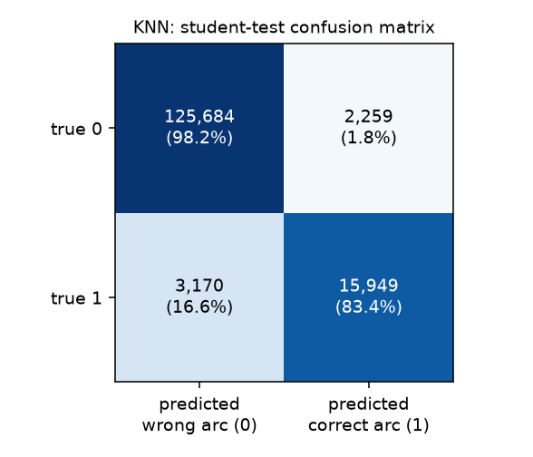

# Model 3: KNN

**Algorithm family:** Instance-based  
**Configuration:** StandardScaler + distance-weighted KNN, k=31, 80k training rows  
**Training rows:** 80,779 (observation, candidate) pairs from 80 training trips  
**Training time:** 0.0 s · **Inference:** 0.7918 ms per GPS observation  
**Rank among 7 models:** #5 on student-test Top-1, #5 on CV Top-1

## Headline results

| CV Macro F1 (mean ± sd) | CV Top-1 (mean ± sd) | Student-test Top-1 | Student-test Macro F1 | Student-test log loss |
|---|---|---|---|---|
| 0.9108 ± 0.0178 | 0.8459 ± 0.0359 | 0.8660 | 0.9167 | 0.1153 |

## Why this model was tried
Candidates with similar geometry (distance profile, heading agreement, context) should have the same label. KNN uses this directly without assuming any functional form.

## Strengths and limitations for PathSnap
Strengths: non-parametric and captures local non-linear structure. Limitations: inference cost grows with the size of the training set (we had to subsample to 80 k rows), it needs careful feature scaling, and its probabilities are coarse vote fractions.

## Hyper-parameters (initial values)
k = 31, distance weighting, Euclidean metric on standardised features, 80 k training rows.

## Loss / objective
None (lazy learner). The neighbours vote at prediction time.

## Cross-validation: 5-fold GroupKFold over the 80 training trips (grouped by trip)

| Fold | Macro F1 | Top-1 | Log loss | Accuracy | Precision (macro) | Recall (macro) | Train Macro F1 | Fit time (s) |
|---|---|---|---|---|---|---|---|---|
| 0 | 0.9045 | 0.8328 | 0.1773 | 0.9536 | 0.9142 | 0.8955 | 1.0000 | 0.0362 |
| 1 | 0.9348 | 0.9043 | 0.1223 | 0.9671 | 0.9451 | 0.9252 | 1.0000 | 0.0374 |
| 2 | 0.8974 | 0.8143 | 0.1497 | 0.9548 | 0.9143 | 0.8824 | 1.0000 | 0.0346 |
| 3 | 0.9239 | 0.8546 | 0.1088 | 0.9665 | 0.9347 | 0.9138 | 1.0000 | 0.0339 |
| 4 | 0.8933 | 0.8236 | 0.1560 | 0.9538 | 0.9100 | 0.8784 | 1.0000 | 0.0342 |
| mean | 0.9108 | 0.8459 | 0.1428 | 0.9591 | 0.9236 | 0.8991 | 1.0000 | 0.0353 |
| std | 0.0178 | 0.0359 | 0.0273 | 0.0070 | 0.0154 | 0.0201 | 0.0000 | 0.0015 |

## Student-test results (10 trips)

| Metric | Value |
|---|---|
| Observation-level Top-1 accuracy | 0.8660 |
| Macro F1 | 0.9167 |
| Accuracy (candidate pairs) | 0.9631 |
| Precision (macro) | 0.9257 |
| Recall (macro) | 0.9083 |
| Precision (correct-arc class) | 0.8759 |
| Recall (correct-arc class) | 0.8342 |
| Log loss | 0.1153 |
| Route continuity (classifier only) | 0.9391 |

## Confusion matrix (student-test candidate pairs, threshold 0.5)



TN = 125,684 wrong candidates correctly rejected · FP = 2,259 wrong candidates accepted · FN = 3,170 correct arcs missed · TP = 15,949 correct arcs found.

## Over- or under-fitting?
Training Macro F1 = 1.0000, CV Macro F1 = 0.9108 (sd 0.0178 over folds), student-test Macro F1 = 0.9167. The training score of 1.0 is not evidence of real fit quality. With distance weighting, each training row is its own nearest neighbour with infinite weight. The relevant gap is between CV and student-test.

## Reproduce
```bash
python scripts/models/train_knn.py
```
Saved model: `models/experiments/KNN.joblib`. Raw fold results: [`cv_folds.csv`](cv_folds.csv).
