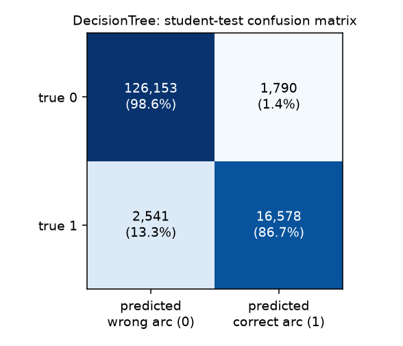

# Model 4: DecisionTree

**Algorithm family:** Tree-based  
**Configuration:** CART, gini, max_depth=12, min_samples_leaf=50  
**Training rows:** 1,323,512 (observation, candidate) pairs from 80 training trips  
**Training time:** 42.8 s · **Inference:** 0.0019 ms per GPS observation  
**Rank among 7 models:** #2 on student-test Top-1, #4 on CV Top-1

## Headline results

| CV Macro F1 (mean ± sd) | CV Top-1 (mean ± sd) | Student-test Top-1 | Student-test Macro F1 | Student-test log loss |
|---|---|---|---|---|
| 0.9234 ± 0.0170 | 0.8590 ± 0.0313 | 0.8891 | 0.9338 | 0.0783 |

## Why this model was tried
Map-matching decisions look like rules ("closest candidate AND heading within 30° AND neighbours also close"). A tree learns such rules and their interactions without scaling.

## Strengths and limitations for PathSnap
Strengths: interpretable, models interactions, fast inference. Limitations: high variance, and piecewise-constant probabilities that hurt log loss and give the HMM coarser emissions.

## Hyper-parameters (initial values)
criterion = gini, max_depth = 12, min_samples_leaf = 50.

## Loss / objective
Greedy reduction of Gini impurity at each split (no global loss).

## Cross-validation: 5-fold GroupKFold over the 80 training trips (grouped by trip)

| Fold | Macro F1 | Top-1 | Log loss | Accuracy | Precision (macro) | Recall (macro) | Train Macro F1 | Fit time (s) |
|---|---|---|---|---|---|---|---|---|
| 0 | 0.9144 | 0.8425 | 0.1238 | 0.9586 | 0.9269 | 0.9030 | 0.9426 | 23.5211 |
| 1 | 0.9450 | 0.9089 | 0.0802 | 0.9720 | 0.9522 | 0.9382 | 0.9331 | 29.1080 |
| 2 | 0.9154 | 0.8360 | 0.1117 | 0.9617 | 0.9211 | 0.9099 | 0.9407 | 33.7525 |
| 3 | 0.9375 | 0.8708 | 0.0769 | 0.9721 | 0.9412 | 0.9339 | 0.9366 | 41.9730 |
| 4 | 0.9047 | 0.8369 | 0.1088 | 0.9579 | 0.9133 | 0.8966 | 0.9450 | 34.4357 |
| mean | 0.9234 | 0.8590 | 0.1003 | 0.9645 | 0.9309 | 0.9163 | 0.9396 | 32.5580 |
| std | 0.0170 | 0.0313 | 0.0206 | 0.0071 | 0.0157 | 0.0187 | 0.0047 | 6.8404 |

## Student-test results (10 trips)

| Metric | Value |
|---|---|
| Observation-level Top-1 accuracy | 0.8891 |
| Macro F1 | 0.9338 |
| Accuracy (candidate pairs) | 0.9705 |
| Precision (macro) | 0.9414 |
| Recall (macro) | 0.9266 |
| Precision (correct-arc class) | 0.9025 |
| Recall (correct-arc class) | 0.8671 |
| Log loss | 0.0783 |
| Route continuity (classifier only) | 0.9495 |

## Confusion matrix (student-test candidate pairs, threshold 0.5)



TN = 126,153 wrong candidates correctly rejected · FP = 1,790 wrong candidates accepted · FN = 2,541 correct arcs missed · TP = 16,578 correct arcs found.

## Over- or under-fitting?
Training Macro F1 = 0.9375, CV Macro F1 = 0.9234 (sd 0.0170 over folds), student-test Macro F1 = 0.9338. Training, CV and student-test scores are close, so there is no significant over- or under-fitting.

## Reproduce
```bash
python scripts/models/train_decision_tree.py
```
Saved model: `models/experiments/DecisionTree.joblib`. Raw fold results: [`cv_folds.csv`](cv_folds.csv).
