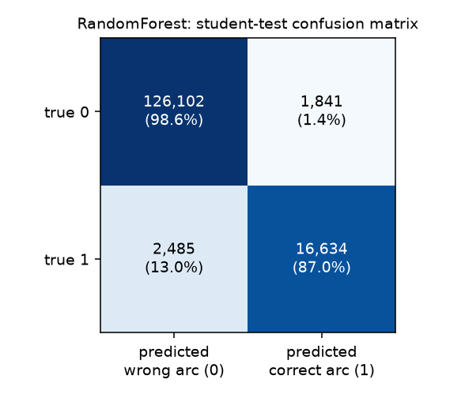

# Model 5: RandomForest

**Algorithm family:** Ensemble (bagging)  
**Configuration:** 100 trees, max_depth=16, min_samples_leaf=20, max_samples=0.3, sqrt features  
**Training rows:** 1,323,512 (observation, candidate) pairs from 80 training trips  
**Training time:** 35.8 s · **Inference:** 0.0126 ms per GPS observation  
**Rank among 7 models:** #3 on student-test Top-1, #1 on CV Top-1

## Headline results

| CV Macro F1 (mean ± sd) | CV Top-1 (mean ± sd) | Student-test Top-1 | Student-test Macro F1 | Student-test log loss |
|---|---|---|---|---|
| 0.9275 ± 0.0165 | 0.8651 ± 0.0317 | 0.8828 | 0.9340 | 0.0717 |

## Why this model was tried
Bagging many decorrelated trees keeps the rule-like behaviour of a tree but averages away its variance, giving smoother probabilities.

## Strengths and limitations for PathSnap
Strengths: robust, little tuning, good generalisation. Limitations: large model files and slower inference than boosting. Its probabilities are averaged votes and can be under-confident.

## Hyper-parameters (initial values)
n_estimators = 100, max_depth = 16, min_samples_leaf = 20, max_samples = 0.3, max_features = sqrt.

## Loss / objective
Each tree minimises Gini impurity on a bootstrap sample. The ensemble averages the trees' class probabilities.

## Cross-validation: 5-fold GroupKFold over the 80 training trips (grouped by trip)

| Fold | Macro F1 | Top-1 | Log loss | Accuracy | Precision (macro) | Recall (macro) | Train Macro F1 | Fit time (s) |
|---|---|---|---|---|---|---|---|---|
| 0 | 0.9185 | 0.8478 | 0.0997 | 0.9603 | 0.9272 | 0.9103 | 0.9443 | 26.8260 |
| 1 | 0.9485 | 0.9157 | 0.0659 | 0.9738 | 0.9562 | 0.9412 | 0.9363 | 23.0233 |
| 2 | 0.9203 | 0.8419 | 0.0900 | 0.9644 | 0.9317 | 0.9098 | 0.9441 | 28.8311 |
| 3 | 0.9409 | 0.8769 | 0.0639 | 0.9738 | 0.9480 | 0.9342 | 0.9394 | 26.9054 |
| 4 | 0.9093 | 0.8431 | 0.0934 | 0.9605 | 0.9238 | 0.8960 | 0.9467 | 27.9535 |
| mean | 0.9275 | 0.8651 | 0.0826 | 0.9666 | 0.9374 | 0.9183 | 0.9422 | 26.7079 |
| std | 0.0165 | 0.0317 | 0.0165 | 0.0068 | 0.0140 | 0.0188 | 0.0042 | 2.2186 |

## Student-test results (10 trips)

| Metric | Value |
|---|---|
| Observation-level Top-1 accuracy | 0.8828 |
| Macro F1 | 0.9340 |
| Accuracy (candidate pairs) | 0.9706 |
| Precision (macro) | 0.9405 |
| Recall (macro) | 0.9278 |
| Precision (correct-arc class) | 0.9004 |
| Recall (correct-arc class) | 0.8700 |
| Log loss | 0.0717 |
| Route continuity (classifier only) | 0.9541 |

## Confusion matrix (student-test candidate pairs, threshold 0.5)



TN = 126,102 wrong candidates correctly rejected · FP = 1,841 wrong candidates accepted · FN = 2,485 correct arcs missed · TP = 16,634 correct arcs found.

## Over- or under-fitting?
Training Macro F1 = 0.9420, CV Macro F1 = 0.9275 (sd 0.0165 over folds), student-test Macro F1 = 0.9340. Training, CV and student-test scores are close, so there is no significant over- or under-fitting.

## Reproduce
```bash
python scripts/models/train_random_forest.py
```
Saved model: `models/experiments/RandomForest.joblib`. Raw fold results: [`cv_folds.csv`](cv_folds.csv).
