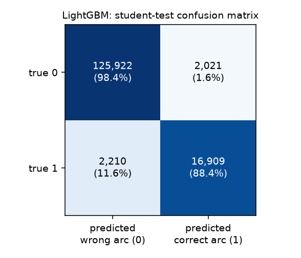
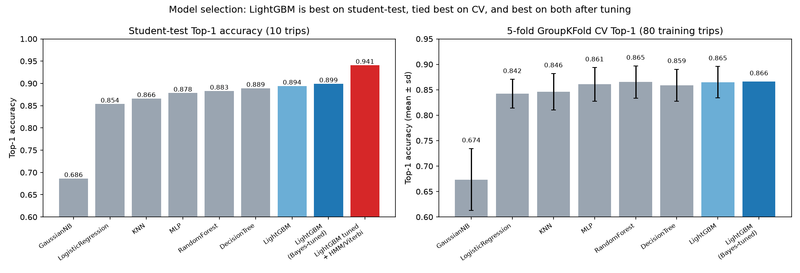
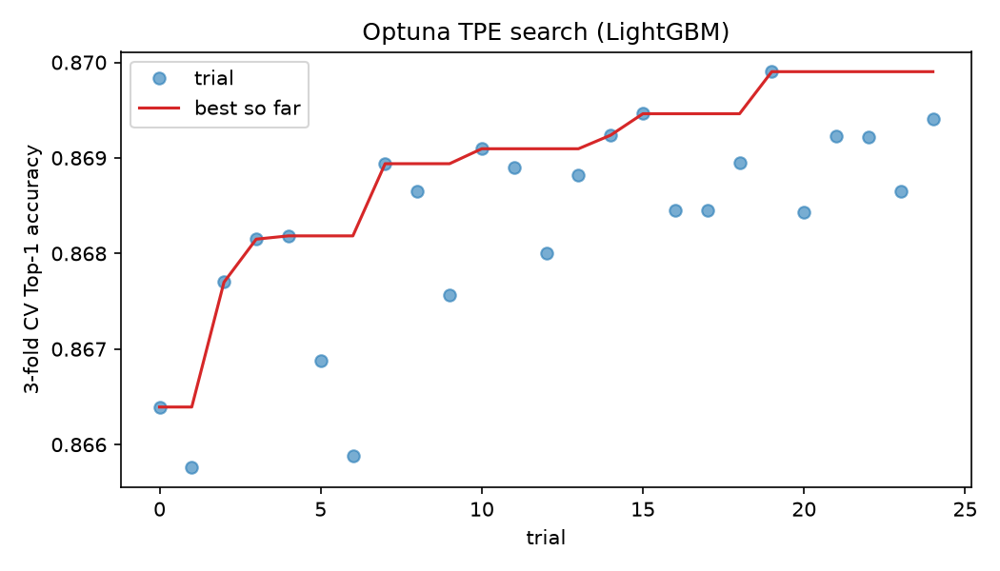
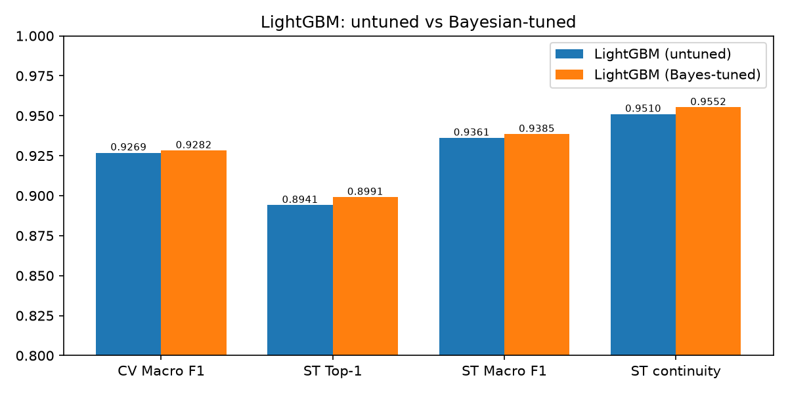
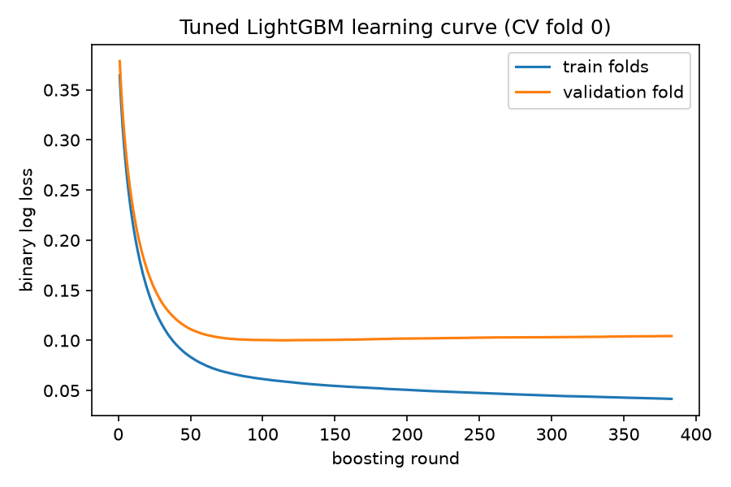

# Model 6: LightGBM (SELECTED MODEL)

**Algorithm family:** Boosting  
**Configuration:** LightGBM defaults: 100 trees, 31 leaves, lr=0.1  
**Training rows:** 1,323,512 (observation, candidate) pairs from 80 training trips  
**Training time:** 3.8 s · **Inference:** 0.0090 ms per GPS observation  
**Rank among 7 models:** #1 on student-test Top-1, #2 on CV Top-1

## Headline results

| CV Macro F1 (mean ± sd) | CV Top-1 (mean ± sd) | Student-test Top-1 | Student-test Macro F1 | Student-test log loss |
|---|---|---|---|---|
| 0.9269 ± 0.0158 | 0.8648 ± 0.0308 | 0.8941 | 0.9361 | 0.0727 |

## Why this model was tried
Gradient-boosted trees are the strongest general-purpose learners for tabular features with interactions, such as our relative-distance × heading × context features. They optimise log loss directly, which suits the HMM.

## Strengths and limitations for PathSnap
Strengths: best accuracy, fast histogram training on 1.3 M rows, no scaling needed. Limitations: many interacting hyper-parameters, and it can overfit with large trees or too many rounds (we control this with group CV).

## Hyper-parameters (initial values)
Library defaults: n_estimators = 100, learning_rate = 0.1, num_leaves = 31, min_child_samples = 20, no row/feature subsampling, no regularisation.

## Loss / objective
Binary log loss (cross-entropy), minimised by gradient boosting with second-order (Newton) leaf values.

## Cross-validation: 5-fold GroupKFold over the 80 training trips (grouped by trip)

| Fold | Macro F1 | Top-1 | Log loss | Accuracy | Precision (macro) | Recall (macro) | Train Macro F1 | Fit time (s) |
|---|---|---|---|---|---|---|---|---|
| 0 | 0.9178 | 0.8478 | 0.1056 | 0.9595 | 0.9214 | 0.9143 | 0.9455 | 3.3502 |
| 1 | 0.9476 | 0.9134 | 0.0690 | 0.9732 | 0.9518 | 0.9435 | 0.9397 | 4.2801 |
| 2 | 0.9220 | 0.8430 | 0.0920 | 0.9645 | 0.9254 | 0.9188 | 0.9470 | 3.5562 |
| 3 | 0.9383 | 0.8775 | 0.0667 | 0.9723 | 0.9401 | 0.9365 | 0.9434 | 3.7402 |
| 4 | 0.9086 | 0.8422 | 0.0985 | 0.9599 | 0.9199 | 0.8982 | 0.9501 | 4.6516 |
| mean | 0.9269 | 0.8648 | 0.0864 | 0.9659 | 0.9317 | 0.9222 | 0.9451 | 3.9157 |
| std | 0.0158 | 0.0308 | 0.0176 | 0.0066 | 0.0138 | 0.0181 | 0.0039 | 0.5371 |

## Student-test results (10 trips)

| Metric | Value |
|---|---|
| Observation-level Top-1 accuracy | 0.8941 |
| Macro F1 | 0.9361 |
| Accuracy (candidate pairs) | 0.9712 |
| Precision (macro) | 0.9380 |
| Recall (macro) | 0.9343 |
| Precision (correct-arc class) | 0.8932 |
| Recall (correct-arc class) | 0.8844 |
| Log loss | 0.0727 |
| Route continuity (classifier only) | 0.9510 |

## Confusion matrix (student-test candidate pairs, threshold 0.5)



TN = 125,922 wrong candidates correctly rejected · FP = 2,021 wrong candidates accepted · FN = 2,210 correct arcs missed · TP = 16,909 correct arcs found.

## Over- or under-fitting?
Training Macro F1 = 0.9435, CV Macro F1 = 0.9269 (sd 0.0158 over folds), student-test Macro F1 = 0.9361. Training, CV and student-test scores are close, so there is no significant over- or under-fitting.

## Why it was selected
Model selection. Two models clearly lead on the primary metric (CV Top-1 on the
training trips): Random Forest (0.8651 ± 0.0317) and LightGBM
(0.8648 ± 0.0308). They are ahead of MLP, DecisionTree. The gap between the two
(0.0003) is about 1/100 of the fold-to-fold standard deviation, so on CV they
are statistically tied (CV Macro F1 0.9275 vs 0.9269, log loss
0.0826 vs 0.0864). We therefore used the secondary criteria:
(1) generalisation to the student-test trips: Top-1 0.8941 (LightGBM) vs 0.8828 (RF),
Macro F1 0.9361 vs 0.9340;
(2) inference cost for the API: 0.0090 vs 0.0126 ms per observation;
(3) model size: 0.2 MB vs 10.4 MB;
(4) room for improvement through tuning: LightGBM has many influential hyper-parameters, and its untuned
configuration is only the library default.
Both produce well-calibrated probabilities (similar log loss), which the HMM uses as emissions. LightGBM was
selected and taken forward to Bayesian optimisation. Training accuracy was not used for the decision.



## Bayesian hyper-parameter optimisation (Optuna TPE)
Objective: mean 3-fold GroupKFold observation Top-1 accuracy (80 train trips). Trials: 25. Best 3-fold CV Top-1: 0.8699.

**Best parameters:** `n_estimators` = 383, `learning_rate` = 0.04557, `num_leaves` = 102, `min_child_samples` = 26, `subsample` = 0.9536, `colsample_bytree` = 0.9473, `reg_lambda` = 0.00442, `reg_alpha` = 0.2011

| Model | CV Macro F1 | CV Top-1 | CV log loss | ST Top-1 | ST Macro F1 | ST log loss | ST continuity | Fit time (s) | Inference (ms/obs) |
|---|---|---|---|---|---|---|---|---|---|
| LightGBM (untuned) | 0.9269 | 0.8648 | 0.0864 | 0.8941 | 0.9361 | 0.0727 | 0.9510 | 3.2340 | 0.0070 |
| LightGBM (Bayes-tuned) | 0.9282 | 0.8661 | 0.0836 | 0.8991 | 0.9385 | 0.0674 | 0.9552 | 13.2560 | 0.0320 |







## After HMM/Viterbi decoding (final system, 10 student-test trips)

Decoder: beta = 2.0 m, emission weight = 1.0, chain break after 60 s gap.

| | Top-1 | Route continuity | Route F1 |
|---|---|---|---|
| Tuned LightGBM only | 0.8999 | 0.9538 | 0.8764 |
| Tuned LightGBM + HMM | 0.9408 | 0.9788 | 0.9872 |

Final model file: `models/final_model.joblib` (parameters in `models/final_model.json`).

## Reproduce
```bash
python scripts/models/train_lightgbm.py
```
Saved model: `models/experiments/LightGBM.joblib`. Raw fold results: [`cv_folds.csv`](cv_folds.csv).
