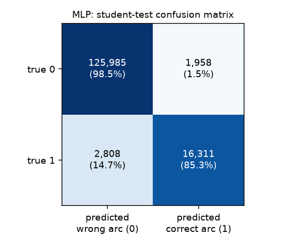
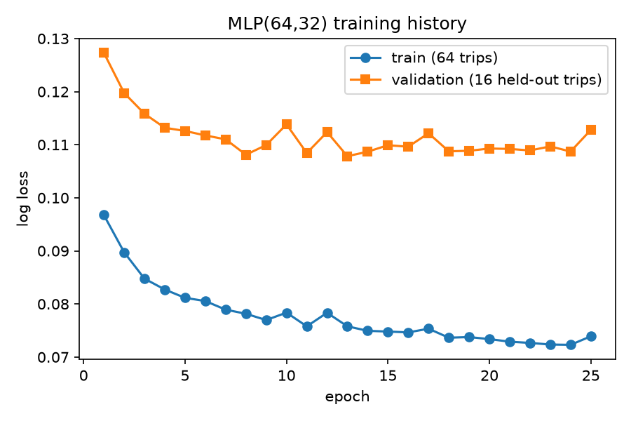

# Model 7: MLP

**Algorithm family:** Neural network  
**Configuration:** StandardScaler + MLP(64,32) ReLU, Adam lr=1e-3, batch 512, early stopping, 300k rows, max 25 epochs  
**Training rows:** 301,161 (observation, candidate) pairs from 80 training trips  
**Training time:** 23.3 s · **Inference:** 0.0039 ms per GPS observation  
**Rank among 7 models:** #4 on student-test Top-1, #3 on CV Top-1

## Headline results

| CV Macro F1 (mean ± sd) | CV Top-1 (mean ± sd) | Student-test Top-1 | Student-test Macro F1 | Student-test log loss |
|---|---|---|---|---|
| 0.9233 ± 0.0171 | 0.8606 ± 0.0329 | 0.8783 | 0.9270 | 0.0783 |

## Why this model was tried
A neural network can learn non-linear combinations of the features without hand-made interactions. It is the representation-learning point of comparison.

## Strengths and limitations for PathSnap
Strengths: flexible function class with smooth probabilities. Limitations: needs scaling, is sensitive to learning rate and initialisation, is slower to train (we subsampled to 300 k rows) and is harder to explain.

## Hyper-parameters (initial values)
Hidden layers (64, 32), ReLU, Adam with lr = 1e-3, batch 512, L2 alpha = 1e-4, early stopping (10% validation split, patience 5), at most 25 epochs, standardised inputs.

## Loss / objective
Binary cross-entropy + L2 weight penalty, minimised with Adam.

## Cross-validation: 5-fold GroupKFold over the 80 training trips (grouped by trip)

| Fold | Macro F1 | Top-1 | Log loss | Accuracy | Precision (macro) | Recall (macro) | Train Macro F1 | Fit time (s) |
|---|---|---|---|---|---|---|---|---|
| 0 | 0.9168 | 0.8491 | 0.1078 | 0.9594 | 0.9253 | 0.9087 | 0.9395 | 28.9847 |
| 1 | 0.9470 | 0.9148 | 0.0691 | 0.9732 | 0.9574 | 0.9374 | 0.9303 | 28.4383 |
| 2 | 0.9144 | 0.8363 | 0.0996 | 0.9618 | 0.9259 | 0.9038 | 0.9398 | 27.2351 |
| 3 | 0.9341 | 0.8674 | 0.0733 | 0.9708 | 0.9422 | 0.9264 | 0.9335 | 27.2924 |
| 4 | 0.9042 | 0.8357 | 0.1020 | 0.9579 | 0.9152 | 0.8940 | 0.9416 | 27.7751 |
| mean | 0.9233 | 0.8606 | 0.0904 | 0.9646 | 0.9332 | 0.9141 | 0.9369 | 27.9451 |
| std | 0.0171 | 0.0329 | 0.0178 | 0.0069 | 0.0166 | 0.0176 | 0.0048 | 0.7555 |

## Student-test results (10 trips)

| Metric | Value |
|---|---|
| Observation-level Top-1 accuracy | 0.8783 |
| Macro F1 | 0.9270 |
| Accuracy (candidate pairs) | 0.9676 |
| Precision (macro) | 0.9355 |
| Recall (macro) | 0.9189 |
| Precision (correct-arc class) | 0.8928 |
| Recall (correct-arc class) | 0.8531 |
| Log loss | 0.0783 |
| Route continuity (classifier only) | 0.9510 |

## Confusion matrix (student-test candidate pairs, threshold 0.5)



TN = 125,985 wrong candidates correctly rejected · FP = 1,958 wrong candidates accepted · FN = 2,808 correct arcs missed · TP = 16,311 correct arcs found.

## Over- or under-fitting?
Training Macro F1 = 0.9319, CV Macro F1 = 0.9233 (sd 0.0171 over folds), student-test Macro F1 = 0.9270. In the epoch history (Figure 10), validation loss is lowest at epoch 13 (0.1078), while training loss keeps falling to 0.0739. Validation loss rising after that point is a mild sign of overfitting, which early stopping limits. Training, CV and student-test scores are close, so there is no significant over- or under-fitting.

## Training history (epoch-wise loss)

64 training trips for fitting, 16 held-out training trips for validation.



## Reproduce
```bash
python scripts/models/train_mlp.py
```
Saved model: `models/experiments/MLP.joblib`. Raw fold results: [`cv_folds.csv`](cv_folds.csv).
